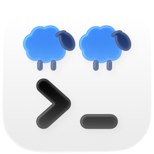
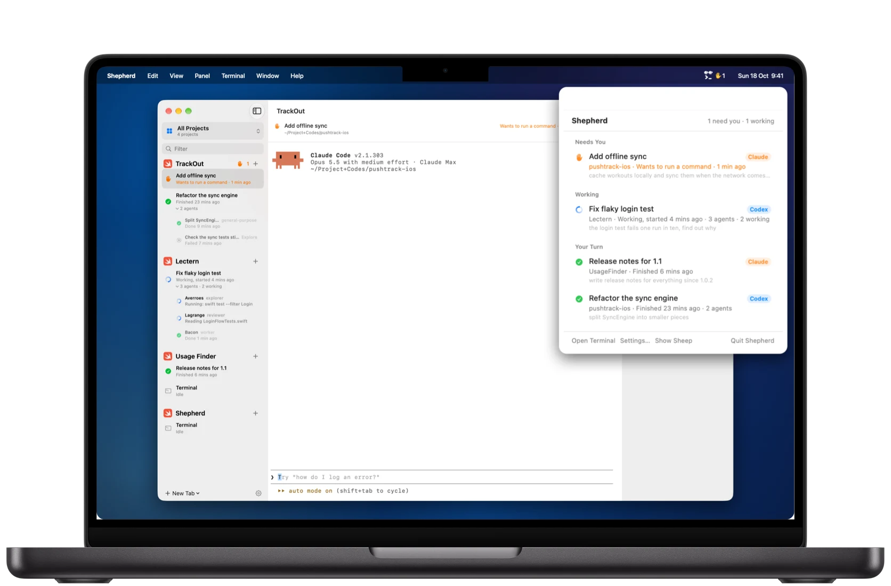
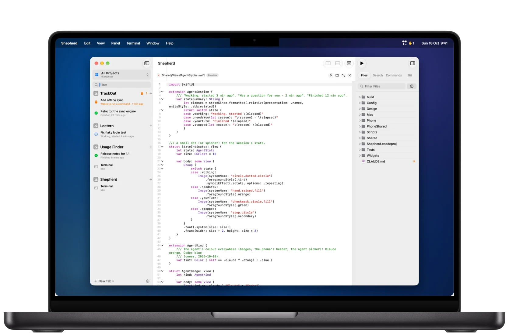
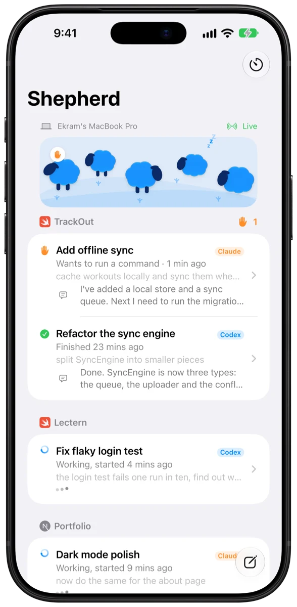
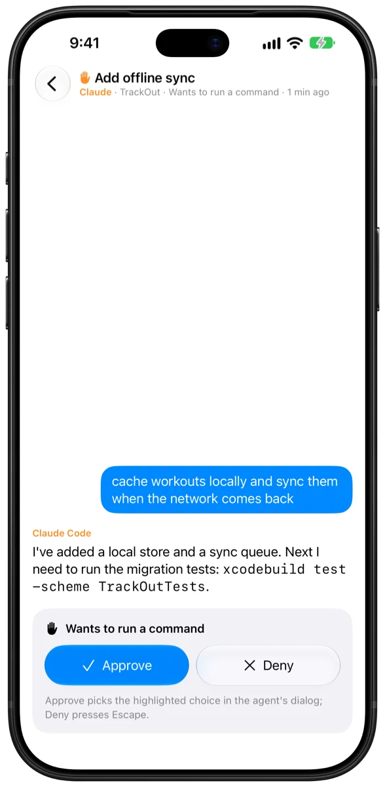
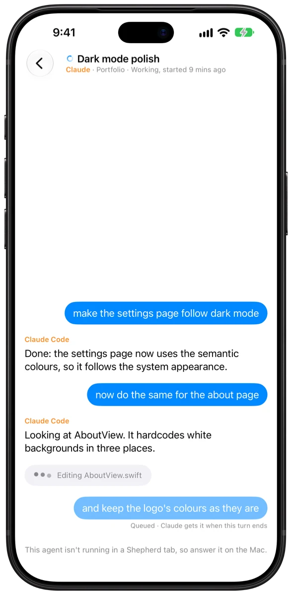
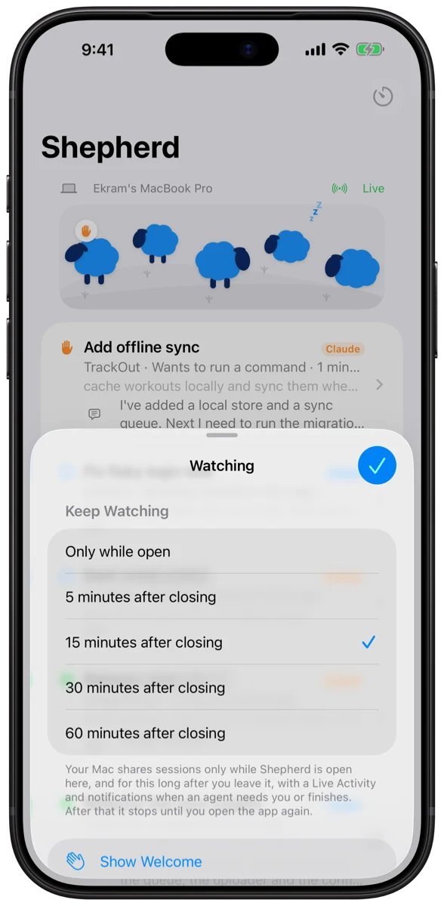

  <picture>
    <source media="(prefers-color-scheme: dark)" srcset="images/icon-dark.png">
    
  </picture>

<h1 align="center">Shepherd</h1>

A native macOS app for working with AI coding agents. Shepherd is a terminal built for agents, with projects, tabs and split panes, a file browser, search, saved commands, a Git page and a code editor. It watches every **Claude Code** and **Codex** session running in its tabs and shows what each one is doing: needs you, working, your turn, or stopped. It tells you when one finishes or needs you, and brings its tab forward with one click.

This repository hosts the signed and notarized downloads.

## Download

**[Download the latest version](https://github.com/ekramjim/Shepherd-Releases/releases/latest/download/Shepherd.dmg)** · [All releases](https://github.com/ekramjim/Shepherd-Releases/releases)

Requires macOS 26 or later.

1. Open `Shepherd.dmg`.
2. Drag **Shepherd** to **Applications**.
3. Open it from Applications. Your agents appear in the menu bar, and the terminal window opens alongside.

## Shepherd on iPhone

Coming soon: follow your agents from your phone, with alerts and a Live Activity, and approve, deny, stop or reply to them. It talks to your Mac only through your own private iCloud, and only while you're using it.

  
  
  
  

## Updates

Shepherd updates itself. Choose **Shepherd → Check for Updates…**, or let it check automatically once a day (**Settings → Agents → Updates**). Every update is signed, notarized by Apple, and verified before it installs.

## Privacy

Shepherd reads your agents' session files locally on your Mac. It has no analytics and no servers of its own. The only network requests are the daily update check and, if you use Shepherd on iPhone, your own private iCloud database. Read the full [privacy policy](PRIVACY.md).

## Support

Questions, bugs or ideas: [open an issue](https://github.com/ekramjim/Shepherd-Releases/issues) or email [ekram@lynksphere.com](mailto:ekram@lynksphere.com).

---

Made by [LynkSphere](https://lynksphere.com).
